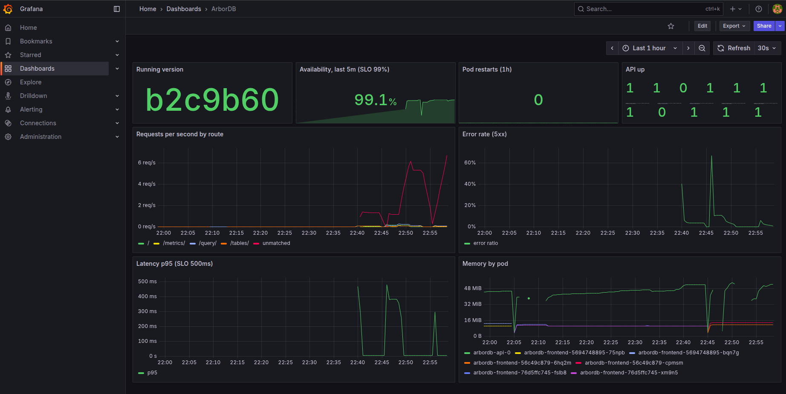

# Evidence

Baseline: [`83cb207`](https://github.com/Yash020405/ArborDB/commit/83cb207e72ca1f86f13bdffb23581589299f2f7f). All changes are on the `feature/k8s-deploy` branch.

Everything below was produced against the deployed version `b2c9b60` and can be re-checked with `./scripts/verify.sh` on a running cluster.

## 1. Commit to running version

| Step | Evidence |
|---|---|
| Commit | [`b2c9b60`](https://github.com/Yash020405/ArborDB/commit/b2c9b60) pushed to `feature/k8s-deploy` |
| Pipeline | [run #4](https://github.com/Yash020405/ArborDB/actions/runs/39148206828): API tests, engine tests, frontend build, Trivy dependency and secret scan, image build and image scan all passed. The API image push hit a GHCR `unknown blob` error on the first attempt and passed when the job was re-run |
| Images | `ghcr.io/yash020405/arbordb-api:b2c9b60` and `ghcr.io/yash020405/arbordb-frontend:b2c9b60` |
| Approval | the `production` environment needs a reviewer; the deploy was approved by Yash020405 |
| Deploy | [deploy job](https://github.com/Yash020405/ArborDB/actions/runs/39148206828/job/117737232932): images loaded into kind, `helm upgrade --atomic` reached revision 23, and the smoke test printed `running version: b2c9b60` and `query round trip OK` |
| Running | `GET https://arbordb.localhost/api/health` returns `"version":"b2c9b60"`; the same SHA is on the pod image, the pod label, every log line and the `arbordb_build_info` metric |

## 2. End-to-end checks

Output: [evidence/verify.txt](evidence/verify.txt) (12 passed, 0 failed).

| Claim | Check |
|---|---|
| Running version matches the commit | Helm release tag = pod image tag = `/api/health` version = git commit |
| User journey works | HTTP redirects to HTTPS, the UI loads, and a SQL insert then select through `/api` returns the row |
| Data survives a pod loss | the API pod is deleted and recreated, and the row written before is still there |
| Frontend stays up if a node goes | the 2 replicas run on different nodes |
| Security controls are active | Pod Security `restricted` enforced, non-root, read-only root filesystem, a NetworkPolicy that blocks a test pod in `default`, and a CI deployer that can't touch other namespaces |
| Monitoring works | Prometheus scrapes the API, sees the deployed version and has the 3 alert rules loaded; logs are JSON with request IDs |

Cluster objects: [evidence/cluster-state.txt](evidence/cluster-state.txt).

## 3. Bad release and recovery

Output: [evidence/bad-release-demo.txt](evidence/bad-release-demo.txt), from `scripts/demo-bad-release.sh`.

I deployed a release with an image tag that doesn't exist. The API pod went to `ErrImagePull` and `/api/health` returned 503. `--atomic` was expected to roll the release back.

Helm marked the upgrade failed and reverted the StatefulSet to the previous image, but the API pod stayed on the bad image, because Kubernetes doesn't replace a StatefulSet pod that never became ready. The frontend answered 200 the whole time, while the API was down since it has one replica.

Deleting the stuck pod brought the previous version back, and the pipeline now does this in its failure step. After that the smoke test passed on `b2c9b60` and the data was intact.

## 4. Alert fires and resolves

Output: [evidence/alert-demo.txt](evidence/alert-demo.txt).

I scaled the API to 0 and requests failed straight away. `ArborDBApiDown` went pending, fired after its 2 minute window, and reached Alertmanager as `critical` with the runbook link. After the runbook fix (scaling back to 1) the alert cleared and the smoke test passed.

During the bad release test the API was down for about 90 seconds, and the alert went pending without firing. That is what the `for: 2m` window is for, so a short blip during a deploy doesn't page anyone.

## 5. Dashboard

Taken just before 23:00 on version `b2c9b60`, showing the last hour. The dips between 22:40 and 22:55 are the deploy, the bad release test and the alert test. API up shows one value per API pod that existed in that hour, since both tests and `verify.sh` recreate the pod.

Two things on it come from my traffic script rather than the deployment, and I traced both through the request logs:
- The large `unmatched` line is requests rejected with 429 by the app's rate limiter. The script sent about 5 requests a second from one IP, well over the limit of 100 per 15 minutes, and a rejected request has no route.
- The 5xx spikes and the 99.1% availability come from the script inserting rows that already existed. The engine rejects them as duplicate keys, and the API reports engine errors as 502. A duplicate key is a client error, so returning 409 for it would keep these out of the error rate. The API's error mapping predates this project, and I left it as it is.

## 6. Problems found along the way

| Found by | Problem | Fix |
|---|---|---|
| calling `/health` 105 times | the rate limiter returned 429 to health checks, so probes would restart a healthy pod | health and metrics routes registered before the limiter; `trust proxy` set |
| Trivy dependency scan | 14 HIGH/CRITICAL vulnerabilities in multer, joi, proxy-addr, xlsx, axios and form-data | all upgraded, tests still pass |
| Trivy image scan in CI | CRITICAL OpenSSL and perl vulnerabilities in the base images | moved to `node:22.23.3-trixie-slim` and `nginx-unprivileged:1.30.6-alpine` |
| first container run | the API also loads the JS SQL parser from `engine/src/query` | copied into the image |
| first ingress test | the ingress controller landed on a worker, but ports 80/443 are mapped to the control plane | pinned to the `ingress-ready` node in the setup script |
| bad release test | stuck StatefulSet pod after rollback | recovery step in the pipeline |
| verify script | frontend pods ended up on one node after a rollout | strict spread rule, counted per version with `matchLabelKeys: [pod-template-hash]` |

## 7. Tests

- API: 184 Jest tests (180 existing and 4 new for the probe routes, request IDs, `/ready` and Prometheus metrics)
- Engine: 9 C++ test suites (`make -C engine test`)
- Frontend: lint and production build
